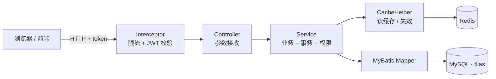
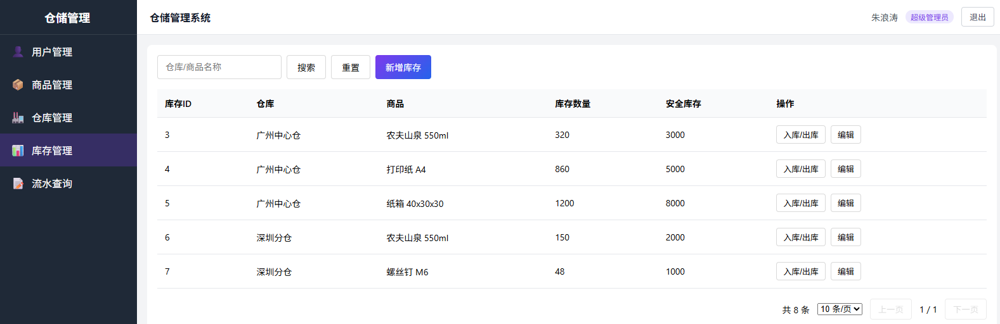
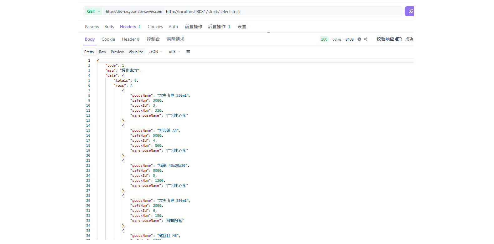

# 仓储管理系统（后端）

> 基于 Spring Boot 的仓储管理后端服务：仓库、商品、库存与出入库流水，包含并发扣减、旁路缓存、接口限流与 JWT 认证。

一个完整的仓储管理后端，覆盖「建仓 → 建品 → 建库存 → 出入库 → 查流水」的完整链路。
除了基础 CRUD，重点处理了三件事：**并发下的库存安全**、**热点列表的缓存**、**接口的流量控制**。

---

## 功能

- **认证**：JWT 无状态登录，拦截器统一校验并把 `role` / `id` 注入请求上下文
- **仓库管理**：增删改查、逻辑删除、分页
- **商品管理**：增删改查、编码查重、分页、按名称/时间模糊查询
- **库存管理**：按「仓库 × 商品」建立库存，增减数量，安全值上限校验
- **出入库流水**：库存数量每次变动自动写入流水，可追溯操作人与时间
- **人员管理**：账号增删改查、角色控制
- **限流**：基于 Redis `INCR + 过期`，单 IP 20 秒内最多 20 次
- **缓存**：列表接口走 Redis 旁路缓存，写入时主动失效
- **工程化**：统一返回结构、全局异常处理、参数校验、配置外置

---

## 技术栈

| 分层 | 选型 |
| --- | --- |
| 语言 / 运行时 | Java 17 |
| 框架 | Spring Boot 4.0.8、Spring MVC |
| 持久层 | MyBatis 4.0.1（XML 写 SQL）、MySQL 8 |
| 缓存 / 限流 | Redis（Spring Data Redis，StringRedisTemplate） |
| 认证 | JJWT 0.11.5（HS256）、BCrypt 密码加密 |
| 工具 | Lombok、Hutool、Jakarta Validation |
| 构建 | Maven |

---

## 系统架构



一次请求经过四层：**拦截器**（限流、验签、注入身份）→ **Controller**（只做参数接收和返回封装）→ **Service**（业务逻辑、事务、权限判断）→ **Mapper**（SQL）。列表读取在 Service 层先查 Redis，未命中再查库并回写。

---

## 目录结构

```
chanku
├── src/main/java/com/chat
│   ├── ChankuApplication.java    启动类
│   ├── controller/               5 个模块的接口
│   ├── service/                  业务接口
│   │   └── impl/                 业务实现（事务、权限、缓存）
│   ├── mapper/                   数据访问接口
│   ├── pojo/
│   │   ├── dto/                  接收前端参数
│   │   ├── po/                   对应数据库表
│   │   ├── vo/                   返回给前端
│   │   └── Result.java           统一返回结构
│   ├── config/                   拦截器注册、密码加密器
│   ├── interceptor/              登录校验 + 限流
│   ├── exception/                业务异常 + 全局异常处理
│   └── until/                    JWT、缓存工具
└── src/main/resources
    ├── application.yaml          配置（密码等从环境变量读取）
    └── com/chat/mapper/*.xml     SQL 映射文件
```

---

## 快速开始

### 1. 准备数据库

MySQL 中创建库 `tlias`，包含 5 张表：

| 表 | 说明 |
| --- | --- |
| `login` | 账号、密码（BCrypt）、角色 |
| `warehouse` | 仓库信息 |
| `goods` | 商品信息 |
| `stock` | 库存（仓库 × 商品 + 数量 + 安全值 + 版本号） |
| `stock_record` | 出入库流水 |

### 2. 配置

复制环境变量模板并填入自己的值：

```bash
cp .env.example .env
```

```properties
DB_USER=root
DB_PASSWORD=你的数据库密码
REDIS_HOST=127.0.0.1
```

`.env` 已被 `.gitignore` 排除，不会进仓库。

### 3. 启动

```bash
./mvnw spring-boot:run
```

服务默认运行在 `http://localhost:8081`。

### 4. 验证

```bash
# 登录，拿到 token
curl "http://localhost:8081/login?username=你的账号&password=你的密码"

# 带 token 访问业务接口
curl -H "token: 上一步返回的字符串" "http://localhost:8081/goods/selectgoods?page=1&pagesize=5"
```

---

## 接口说明

所有接口统一返回：

```json
{ "code": 1, "msg": "操作成功", "date": { } }
```

`code=1` 成功、`code=0` 失败。除 `/login` 外，所有接口都要求请求头带上 `token`。

| 模块 | 方法 | 路径 | 说明 |
| --- | --- | --- | --- |
| 登录 | GET | `/login` | 账号密码登录，返回 JWT |
| 商品 | POST | `/goods/addgoods` | 新增商品（编码查重） |
| 商品 | GET | `/goods/selectgoods` | 分页查询 |
| 商品 | PUT | `/goods/updategoods` | 修改（乐观锁） |
| 商品 | DELETE | `/goods/deletedoods` | 逻辑删除 |
| 商品 | GET | `/goods/likeselect` | 按名称 / 时间模糊查询 |
| 仓库 | POST | `/ware/addware` | 新增仓库 |
| 仓库 | GET | `/ware/selectware` | 分页查询 |
| 仓库 | PUT | `/ware/updateware` | 修改（乐观锁） |
| 仓库 | DELETE | `/ware/deleteware` | 逻辑删除 |
| 库存 | POST | `/stock/addstock` | 建立库存（仓库 × 商品） |
| 库存 | PUT | `/stock/addnum` | 增减库存数量并记流水 |
| 库存 | PUT | `/stock/updatestock` | 修改库存信息 |
| 库存 | GET | `/stock/selectstock` | 分页查询（联表：仓库名 + 商品名） |
| 流水 | GET | `/stockrecord/selectrecord` | 分页查询流水 |
| 人员 | POST | `/addrole` | 新增账号 |
| 人员 | GET | `/select` | 分页查询账号 |
| 人员 | PUT | `/update` | 修改账号 |
| 人员 | DELETE | `/delete` | 逻辑删除账号 |
| 人员 | GET | `/like` | 按用户名模糊查询 |

> 每个接口的请求参数、请求体字段与响应示例，见 **[docs/api.md](docs/api.md)**。

---

## 几个关键设计

### 1. 库存并发：乐观锁 + 行锁兜底

库存表带 `version` 字段，更新时校验版本号，避免两个事务同时改同一行造成覆盖。
建立库存时先用 `select ... for update` 锁住「仓库 + 商品」这一行，防止并发重复创建。
数量变动前校验安全值上限与下限，超限直接拒绝。

### 2. 缓存：旁路缓存（Cache-Aside）

- 读：先查 Redis，命中直接返回；未命中查库并回写，TTL 60 秒
- 写：数据变更后按前缀删除相关缓存，下次读取自然重建
- 降级：Redis 异常时视为未命中，业务照常走数据库，不影响可用性

### 3. 限流：`INCR` + 过期时间

拦截器里对每个 IP 计数：第一次访问时设置 20 秒过期，窗口内累加，超过 20 次返回 `429` 并带 `Retry-After`。
只在计数为 1 时设过期，避免窗口被不断续期；计数异常时放行（fail-open），限流不能拖垮业务。

### 4. 认证：无状态 JWT

登录成功后签发 token，`claims` 里带 `id` 与 `role`。
拦截器解析后写入请求属性，Service 层据此做权限判断，Controller 不再重复解析。
密钥与有效期来自配置，重启后旧 token 依然有效。

---

## 已知限制

- 分页使用 `LIMIT offset, size`，深分页场景性能会下降
- 缓存失效使用 `KEYS pattern`，数据量增大后应改为 `SCAN`
- 单机部署，未做读写分离与分库分表

## 后续计划

- [ ] 补充 `sql/init.sql`，做到 clone 即可运行
- [ ] 关键业务补充单元测试（库存扣减、权限校验、缓存命中）
- [ ] 接入在线接口文档（springdoc-openapi / Knife4j）
- [ ] Docker Compose 一键启动（MySQL + Redis + 应用）

---

## 截图

| 登录 | 库存列表 |
| --- | --- |
|  |  |

接口调用与缓存效果：




---

## License

MIT
